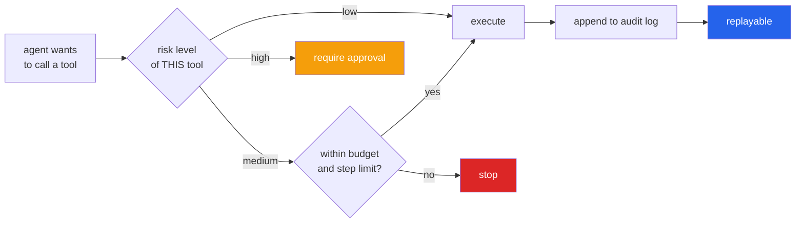

# bounded-agent-runtime

[](https://github.com/hammasbuilds/bounded-agent-runtime/actions/workflows/ci.yml)

We built bounded-agent-runtime as an agent runtime that enforces its own limits: steps, wall time,
cost, tool calls and repeated actions are checked by the runtime before every step, and a tool's risk
tier decides whether it runs or waits for a human. A chaos suite of scripted misbehaving agents proves
the limits hold on every push, with no model or network. It is for developers who want agents with
hard ceilings in code rather than polite requests in a prompt.

A full web UI for this lives in [LLM Control Room](https://github.com/hammasbuilds/llm-control-room)
(Agent runs page).

## What it does

- **Ceilings outside the agent loop:** `max_steps`, `max_seconds`, `max_usd`, `max_tool_calls` and
  `max_repeats` (loop detection by exact repetition of an action fingerprint). Each is checked before
  the step and raises, so a caller cannot ignore it.
- **Per-run budgets and per-tenant quotas:** separate, so many individually well-behaved runs cannot
  exhaust a shared system.
- **Risk tiers per tool:** `READ`, `WRITE`, `EXTERNAL`, `IRREVERSIBLE`. A tool above the autonomous
  ceiling pauses the run intact until a human approves; approval resumes the same run.
- **Audit log and replay:** append-only JSONL flushed per event, so a crashed or stopped run still has a
  full record; `bar replay <run_id>` rebuilds a run without calling the model again.
- **Pluggable planners:** an LLM planner (Ollama, Anthropic or Hugging Face) or scripted ones.
- **HTTP API:** FastAPI app with `/run`, `/runs/{run_id}`, `/metrics` and `/health`.



## Sample input / output

`python demo.py` runs seven scripted planners, each built to misbehave in one way, inside the runtime
(no model needed):

```
INPUT
   7 planners, each given a goal and a budget
   Wellbehaved         finishes on its own
   NeverFinishes       loops forever
   Repeats             same call over and over
   Expensive           burns budget
   Slow                takes too long
   Hallucinates        calls a tool that does not exist
   WantsIrreversible   tries to send real email

OUTPUT
   planner             outcome          steps  reason
   ----------------------------------------------------------------------------------
   Wellbehaved         COMPLETED            2
   NeverFinishes       BUDGET_STOP          5  steps budget exhausted: used 5 of 5
   Repeats             BUDGET_STOP          3  loop budget exhausted: used 3 of 3
   Expensive           BUDGET_STOP          1  cost budget exhausted: used 0.05 of 0.05
   Slow                BUDGET_STOP         19  time budget exhausted: used 1.031 of 1
   Hallucinates        COMPLETED            2
   WantsIrreversible   NEEDS_APPROVAL       1  send_email is IRREVERSIBLE and requires human approval
```

`bar replay` on a stored run (the `Repeats` case):

```
| seq | kind        | detail                                                  |
|-----+-------------+---------------------------------------------------------|
| 1   | start       | goal=Retry the same lookup forever, limits={'steps': 5, |
|     |             | 'tool_calls': 40, 'usd': 0.1, 'seconds': 5.0}           |
| 2   | step        | n=1, tool=search, args={'q': 'same'}, reasoning=        |
| 3   | tool_call   | tool=search, ok=True, observation=results for same      |
| 4   | step        | n=2, tool=search, args={'q': 'same'}, reasoning=        |
| 5   | tool_call   | tool=search, ok=True, observation=results for same      |
| 6   | budget_stop | limit_kind=loop, limit=3, used=3                        |
| 7   | finish      | outcome=budget_stop, reason=loop budget exhausted: used |
|     |             | 3 of 3, steps=3, usd=0.002, seconds=0.0                 |
```

## Results

- In the demo run, four different ceilings fired (steps, loop, cost, time), the approval gate held the
  irreversible email, and two agents completed (`Hallucinates` recovers because an unknown tool name is
  returned to the agent as an error, not a crash).
- 21 tests in the containment suite. The approval test checks the side effect itself: after
  `WantsIrreversible` runs, the list of sent emails is still empty. Loop detection fires before the step
  budget, and an agent alternating between two actions is not flagged.

## Tech stack

- Python 3.12
- FastAPI + uvicorn (HTTP API), Pydantic and pydantic-settings (request models, `.env` config)
- Typer + Rich (the `bar` CLI)
- httpx, tenacity (model calls with retry), `anthropic` SDK
- Dev: pytest, ruff, uv

## Run it

```bash
git clone https://github.com/hammasbuilds/bounded-agent-runtime
cd bounded-agent-runtime
uv sync --all-groups
uv run python demo.py          # seven misbehaving agents, no model needed
uv run pytest -q               # the containment suite
```

To run a real LLM agent inside the runtime (Ollama by default; limits are set in `.env`):

```bash
ollama pull qwen2.5:3b-instruct
cp .env.example .env
uv run bar demo
uv run bar replay <run_id>     # reconstruct any run from its audit log in runs/
uv run uvicorn bar.api.main:app --port 8000   # the HTTP API
```

Code layout: `src/bar/budget/limits.py` (every ceiling), `tools/registry.py` (risk tiers and the
approval gate), `runtime/loop.py` (the loop; `Planner` is a Protocol), `runtime/planner.py` (the LLM
planner), `observe/` (audit log, per-tenant quotas, metrics), `tests/planners.py` (scripted misbehaviour).

## Licence

MIT, see [LICENSE](LICENSE).
